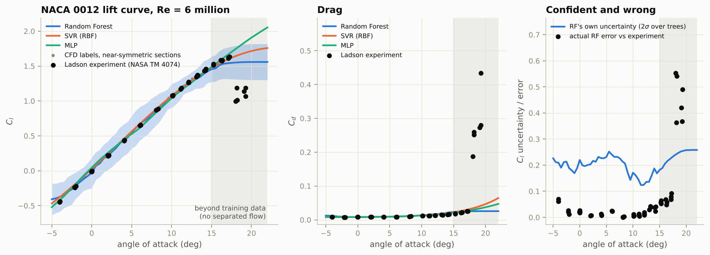
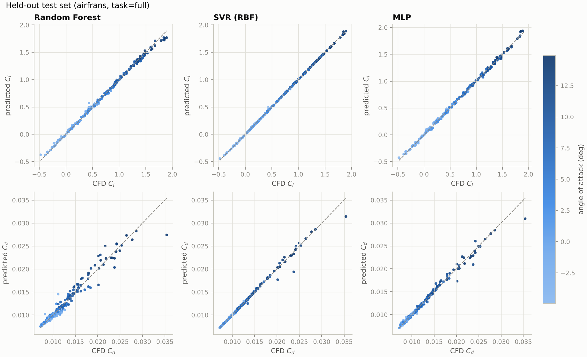
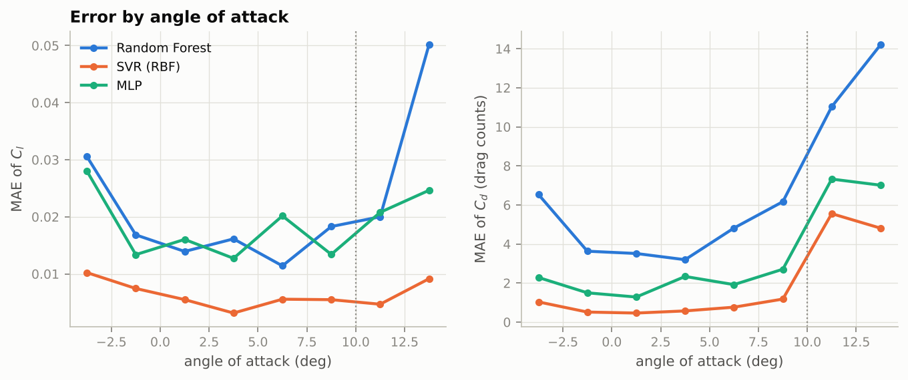
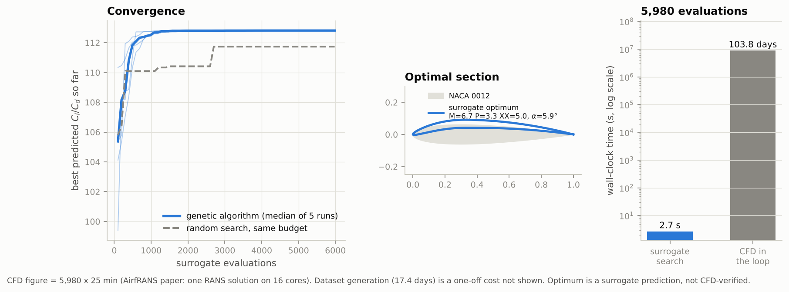

# Surrogate modelling of airfoil lift and drag, and what happens at stall

**Engineering question.** Can a machine-learning surrogate, trained on a few hundred RANS solutions, replace
the CFD solver inside an airfoil design search, and how far can it be trusted when the flow separates?

This project builds a baseline surrogate for the lift and drag coefficients of NACA 4- and 5-digit airfoils,
uses it inside a genetic-algorithm search for maximum lift-to-drag ratio, and then tests it where it should
fail: through stall, against wind-tunnel data for the NACA 0012. The central observation is physical, not
statistical: a model trained almost entirely on attached flow has no way to know that the flow will separate,
so it extrapolates the attached-flow trend and misses the stall.




*Headline result: the surrogates follow the experiment up to the edge of stall, then miss it. Details in section 5.*

> **Status.** All numbers below come from a run of this pipeline on the real AirfRANS dataset (1,000 RANS
> solutions) and the real Ladson wind-tunnel data. Reproduce them with `make all`. Timings were measured on a
> small 2-core cloud machine. The stall comparison rests on a single experiment with only six post-stall points,
> and the optimum in section 4 is a surrogate prediction that has **not** been verified with CFD. Both are
> discussed where they appear.

---

## 1. The data

AirfRANS (Bonnet, Mazari, Cinnella, Gallinari, NeurIPS 2022 Datasets and Benchmarks).

| | |
|---|---|
| Solutions | 1,000 RANS solutions (800 train / 200 test in the published split); 489 four-digit and 511 five-digit sections |
| Solver | OpenFOAM v2112, `simpleFoam` (steady, SIMPLEC) |
| Turbulence model | k-omega SST, wall-resolved (first cell 2 micrometres, y+ about 1) |
| Physics | 2D, steady, incompressible, sea level, 298.15 K |
| Reynolds number | 2 to 6 million (chord 1 m, U about 31 to 94 m/s) |
| Mach number | below 0.3 (the bound that justifies incompressibility; not a sampled variable) |
| Angle of attack | -5 to 15 degrees (the table built here spans -4.9 to 14.9); the upper limit was chosen to avoid stall and unsteady wakes |
| Geometries | NACA 4-digit (M, P, XX) and 5-digit (L, P, Q, XX), real-valued parameters |
| Cost of one solution | about 25 minutes on 16 cores (paper, Table 4) |

Two points that matter for everything below:

- **The coefficients are derived, not stored.** The dataset contains velocity, pressure and eddy-viscosity
  fields. Cl and Cd are obtained by integrating surface pressure and wall shear stress
  (`scripts/01_build_dataset.py`). In the resulting table pressure drag is about 21% of total drag below
  2 degrees but about 72% above 12 degrees: form drag takes over as the flow nears separation.
- **There is essentially no stalled flow in it.** That is a design choice of the dataset, and it is what makes
  the stall question interesting. Details and sources: [`docs/dataset_facts.md`](docs/dataset_facts.md).

## 2. What the surrogate predicts

Inputs (all physically meaningful, see the [primer](docs/physics_primer.md#3-the-input-features-and-what-each-one-means)):
angle of attack, log Reynolds number, maximum thickness, maximum camber and its position, camber at 75% chord,
the thin-airfoil zero-lift angle, and the effective angle `alpha - alpha_L0`.
Outputs: `Cl` and `log10(Cd)`.

Three model families are trained and compared: Random Forest, RBF-kernel SVR and a multilayer perceptron.

## 3. Validation protocol and results

- The published AirfRANS split is used unchanged; the test set is never touched during tuning.
- Hyper-parameters are tuned by **nested** 5-fold cross-validation, grouped by geometry.
- Reported: MAE of Cl, MAE of Cd (in drag counts, 1 count = 0.0001), mean relative error of Cd, and Spearman rank
  correlation of Cl, Cd and Cl/Cd (for design, ordering candidates correctly matters more than the absolute value).
- Every metric is reported overall and split at **alpha = 10 degrees**, the nearest available proxy for "high
  angle of attack" given that the data end at 15.
- `--task aoa` reproduces the dataset's own extrapolation split (train on -2.5 to 12.5 degrees, test on the
  edges): every test row lies outside the training range.

### Held-out test set (200 simulations; 38 of them at alpha >= 10 degrees)

| Model | MAE Cl, all | MAE Cl, alpha >= 10 | MAE Cd (counts), all | MAE Cd (counts), alpha >= 10 | Spearman Cl/Cd, all | Spearman Cl/Cd, alpha >= 10 |
|---|---|---|---|---|---|---|
| Random Forest | 0.0209 | 0.0351 | 6.2 | 12.6 | 0.983 | 0.843 |
| SVR (RBF) | **0.0064** | **0.0069** | **1.6** | **5.2** | **0.998** | **0.957** |
| MLP | 0.0180 | 0.0227 | 3.0 | 7.2 | 0.993 | 0.927 |

Nested-CV results on the 800 training simulations agree (SVR: Cl MAE 0.0066, Cd 2.4 counts), so the test
numbers are not a lucky split. Full tables: `results/airfrans/full/metrics.md`.





Observations. The SVR wins clearly in-distribution, which fits the physics: in the attached regime the map is
smooth and close to linear, and a smooth kernel model suits it better than piecewise-constant trees. For all
models, drag error and the ranking quality of Cl/Cd get worse at higher angle of attack, consistent with form drag
becoming a larger and harder-to-predict share of the total. The alpha >= 10 band has only 38 test points, so
those figures are noisier.

### Extrapolation in angle of attack (`--task aoa`: train -2.5 to 12.5 degrees, test outside it, 196 rows)

| Model | MAE Cl | MAE Cd (counts) | Cl/Cd rank correlation |
|---|---|---|---|
| Random Forest | 0.080 | 21.5 | 0.931 |
| SVR (RBF) | 0.017 | 8.9 | 0.990 |
| MLP | 0.021 | 11.9 | 0.983 |

Beyond the training range, **all three models under-predict drag at both ends** (bias +7 to +36 counts, true minus
predicted), while the SVR's lift bias at alpha > 12.5 is only +0.002. Lift keeps following its straight line;
drag, which curves upward, does not.

## 4. Design optimisation with the surrogate

A genetic algorithm searches over NACA 4-digit camber, camber position, thickness and angle of attack, at a
fixed Reynolds number of 4 million, to maximise predicted Cl/Cd. The bounds are the sampling ranges of the
dataset. Five independent runs are compared with a random-search baseline of equal budget; each search makes
5,980 surrogate evaluations.

| | SVR (headline) | MLP | Random Forest |
|---|---|---|---|
| Best predicted Cl/Cd | 112.8 | 113.7 | 103.8 |
| Random search, same budget | 111.7 | 111.5 | 101.7 |
| Optimal section (M, P, XX) | 6.7, 3.3, 5.0 | 7.0, 3.1, 5.0 | 6.7, 4.6, 6.8 |
| Optimal angle of attack | 5.9 deg | 6.2 deg | 6.8 deg |
| Search wall-clock time | 2.7 s | 2.3 s | 8.6 s |

**Cost accounting, with its assumptions stated.**

- Surrogate: the SVR search of 5,980 evaluations took 2.7 s on a 2-core cloud machine (about 0.45 ms per evaluation).
- CFD in the loop: `5,980 x 25 minutes` is about 104 days, taking the AirfRANS figure for one RANS solution on
  16 cores of a Threadripper 3960X. That is roughly a 3-million-fold difference per search. It is an estimate for
  the *same* number of evaluations; a real CFD optimiser would use a sample-efficient method and far fewer solutions,
  so the ratio overstates the practical advantage over a well-run CFD optimisation.
- The surrogate path has a one-off cost the plot omits: generating the training data (1,000 solutions, about
  17 days at that rate). The break-even is therefore about 1,000 evaluations; the surrogate pays off when searches are
  much larger than that or are repeated across conditions and constraints.

**How much to trust the optimum: not much, yet.**

- It is a **prediction of the surrogate, not a CFD-verified design.**
- The three models disagree: the Random Forest's best Cl/Cd is 8 to 9% lower than the SVR's and MLP's, and its optimal
  shape differs (thicker, with maximum camber further aft).
- The SVR and MLP optima sit on the boundary of the sampled design space (minimum thickness of 5%; the MLP also at the
  maximum camber of 7%), and the SVR optimum lies slightly farther from its nearest training point than 95% of training
  points lie from theirs. Optimisers drift to corners where models are least constrained.
- The GA beats random search by only 1 to 2% in final value (the landscape is smooth in four variables); its
  benefit is speed of convergence. The median GA run is within 0.5 of its final value after about 700 evaluations
  and within 0.1 after about 1,300; at 1,000 evaluations it is at 112.6 while random search is at 110.1, and random
  search needs 2,700 evaluations to reach its own best of 111.7.
- The honest next step is to run the proposed section through OpenFOAM (the dataset authors publish their setup
  at github.com/Extrality/NACA_simulation).

Figures: `results/airfrans/full/optimisation_svr.png` (and `_mlp`, `_random_forest`).



## 5. Validation against experiment, and what happens at stall

The NACA 0012 at Re = 6 million, compared with the tripped-boundary-layer force measurements of Ladson
(NASA TM 4074), which the NASA Turbulence Modeling Resource recommends for fully turbulent CFD validation
(53 points, alpha from -4.0 to 19.3 degrees). The surrogates are evaluated well beyond the 15-degree limit of the
training data.

### The physics, in five lines

1. In attached flow, lift follows `Cl = 2 pi (alpha - alpha_L0)`: linear, because the thin boundary layer is a
   small perturbation of potential flow whose circulation is set by the Kutta condition.
2. As alpha increases, the suction peak steepens the adverse pressure gradient; the boundary layer thickens and
   the wall shear drops to zero. The flow separates.
3. Separation changes the flow's structure rather than its slope: lift reaches a maximum and falls, pressure
   drag takes over, and the wake may become unsteady.
4. Where and when it separates depends on the pressure distribution, which is a *result* of the flow, not an
   input to the model. The map from shape to force becomes a threshold phenomenon.
5. A model fitted to attached flow has no information about the threshold. Whatever its class (trees, kernels,
   ReLU network) it continues the attached-flow trend.

The full argument is in
[`docs/physics_primer.md`](docs/physics_primer.md#8-the-argument-why-a-model-trained-mostly-on-attached-flow-is-confident-and-wrong-near-stall).

### What the experiment shows

In the Ladson data, lift peaks at **Cl = 1.635 at alpha = 17.2 degrees**. At 18.0 degrees and above, lift has
fallen to about 1.0 to 1.2 and drag has jumped from about 0.025 to between 0.19 and 0.43. The stall happens
within one degree.

| | Inside training range (alpha <= 14.9, 38 pts) | Beyond range, still attached (14.9 to 17.5, 9 pts) | Stalled (alpha > 17.5, 6 pts) |
|---|---|---|---|
| Random Forest, MAE of Cl | 0.021 | 0.065 | 0.456 |
| SVR, MAE of Cl | 0.024 | 0.025 | 0.571 |
| MLP, MAE of Cl | 0.032 | 0.025 | 0.701 |

- **Inside the training range** all three agree with experiment to within a few hundredths in Cl.
- **Beyond the range but before stall**, the SVR and MLP still track the experiment (error 0.025): the attached-flow
  trend continues, so extrapolating the lift line works, right up to the edge of stall.
- **At stall they all fail.** At the six stalled points the models predict Cl of about 1.55 (RF), 1.67 (SVR) and
  1.80 (MLP) against a measured mean of 1.10. Predicted drag is 0.026 to 0.038 against a measured mean of 0.28,
  an under-prediction by a factor of 7 to 11. Past 15 degrees the MLP keeps rising almost linearly, the SVR keeps
  rising more slowly, and the Random Forest flattens at about 1.56. None of them bends over.
- **The Random Forest's own uncertainty does not warn.** The spread of the trees (shown as 2 standard deviations)
  is 0.19 inside the training range and 0.25 at the stalled points, a rise of about 30%. The actual error rises from
  0.021 to 0.456, more than twenty-fold, and exceeds the 2-sigma band at all six stalled points. The spread is not
  small; it is roughly constant and carries no information about stall.

Figure: `results/airfrans/full/validation_naca0012.png` (lift, drag, and the uncertainty-versus-error panel).

### What this comparison can and cannot show

- The post-stall evidence is **six points from one experiment**. It is a clear illustration, not a statistical test.
- Near stall, the gap between surrogate and experiment mixes the surrogate's extrapolation error, the error of RANS
  itself in separated flow, and the wind tunnel's departure from two-dimensionality (the NASA TMR notes that
  experiments near stall are far from 2D). Comparing the surrogate with experiment cannot isolate the first.
  Doing so requires stall-resolved CFD labels at the same conditions; the NREL HAM2D set (alpha to 20 degrees) is a
  candidate for extending this work.
- The good agreement below stall says the surrogate reproduces attached-flow experiment well; it does not
  separate the quality of the surrogate from the quality of the RANS labels it learned from.

## Interactive demo

# Surrogate modelling of airfoil lift and drag, and what happens at stall

**Engineering question.** Can a machine-learning surrogate, trained on a few hundred RANS solutions, replace
the CFD solver inside an airfoil design search, and how far can it be trusted when the flow separates?

This project builds a baseline surrogate for the lift and drag coefficients of NACA 4- and 5-digit airfoils,
uses it inside a genetic-algorithm search for maximum lift-to-drag ratio, and then tests it where it should
fail: through stall, against wind-tunnel data for the NACA 0012. The central observation is physical, not
statistical: a model trained almost entirely on attached flow has no way to know that the flow will separate,
so it extrapolates the attached-flow trend and misses the stall.


*Headline result: the surrogates follow the experiment up to the edge of stall, then miss it. Details in section 5.*

> **Status.** All numbers below come from a run of this pipeline on the real AirfRANS dataset (1,000 RANS
> solutions) and the real Ladson wind-tunnel data. Reproduce them with `make all`. Timings were measured on a
> small 2-core cloud machine. The stall comparison rests on a single experiment with only six post-stall points,
> and the optimum in section 4 is a surrogate prediction that has **not** been verified with CFD. Both are
> discussed where they appear.

---

## 1. The data

AirfRANS (Bonnet, Mazari, Cinnella, Gallinari, NeurIPS 2022 Datasets and Benchmarks).

| | |
|---|---|
| Solutions | 1,000 RANS solutions (800 train / 200 test in the published split); 489 four-digit and 511 five-digit sections |
| Solver | OpenFOAM v2112, `simpleFoam` (steady, SIMPLEC) |
| Turbulence model | k-omega SST, wall-resolved (first cell 2 micrometres, y+ about 1) |
| Physics | 2D, steady, incompressible, sea level, 298.15 K |
| Reynolds number | 2 to 6 million (chord 1 m, U about 31 to 94 m/s) |
| Mach number | below 0.3 (the bound that justifies incompressibility; not a sampled variable) |
| Angle of attack | -5 to 15 degrees (the table built here spans -4.9 to 14.9); the upper limit was chosen to avoid stall and unsteady wakes |
| Geometries | NACA 4-digit (M, P, XX) and 5-digit (L, P, Q, XX), real-valued parameters |
| Cost of one solution | about 25 minutes on 16 cores (paper, Table 4) |

Two points that matter for everything below:

- **The coefficients are derived, not stored.** The dataset contains velocity, pressure and eddy-viscosity
  fields. Cl and Cd are obtained by integrating surface pressure and wall shear stress
  (`scripts/01_build_dataset.py`). In the resulting table pressure drag is about 21% of total drag below
  2 degrees but about 72% above 12 degrees: form drag takes over as the flow nears separation.
- **There is essentially no stalled flow in it.** That is a design choice of the dataset, and it is what makes
  the stall question interesting. Details and sources: [`docs/dataset_facts.md`](docs/dataset_facts.md).

## 2. What the surrogate predicts

Inputs (all physically meaningful, see the [primer](docs/physics_primer.md#3-the-input-features-and-what-each-one-means)):
angle of attack, log Reynolds number, maximum thickness, maximum camber and its position, camber at 75% chord,
the thin-airfoil zero-lift angle, and the effective angle `alpha - alpha_L0`.
Outputs: `Cl` and `log10(Cd)`.

Three model families are trained and compared: Random Forest, RBF-kernel SVR and a multilayer perceptron.

## 3. Validation protocol and results

- The published AirfRANS split is used unchanged; the test set is never touched during tuning.
- Hyper-parameters are tuned by **nested** 5-fold cross-validation, grouped by geometry.
- Reported: MAE of Cl, MAE of Cd (in drag counts, 1 count = 0.0001), mean relative error of Cd, and Spearman rank
  correlation of Cl, Cd and Cl/Cd (for design, ordering candidates correctly matters more than the absolute value).
- Every metric is reported overall and split at **alpha = 10 degrees**, the nearest available proxy for "high
  angle of attack" given that the data end at 15.
- `--task aoa` reproduces the dataset's own extrapolation split (train on -2.5 to 12.5 degrees, test on the
  edges): every test row lies outside the training range.

### Held-out test set (200 simulations; 38 of them at alpha >= 10 degrees)

| Model | MAE Cl, all | MAE Cl, alpha >= 10 | MAE Cd (counts), all | MAE Cd (counts), alpha >= 10 | Spearman Cl/Cd, all | Spearman Cl/Cd, alpha >= 10 |
|---|---|---|---|---|---|---|
| Random Forest | 0.0209 | 0.0351 | 6.2 | 12.6 | 0.983 | 0.843 |
| SVR (RBF) | **0.0064** | **0.0069** | **1.6** | **5.2** | **0.998** | **0.957** |
| MLP | 0.0180 | 0.0227 | 3.0 | 7.2 | 0.993 | 0.927 |

Nested-CV results on the 800 training simulations agree (SVR: Cl MAE 0.0066, Cd 2.4 counts), so the test
numbers are not a lucky split. Full tables: `results/airfrans/full/metrics.md`.


Observations. The SVR wins clearly in-distribution, which fits the physics: in the attached regime the map is
smooth and close to linear, and a smooth kernel model suits it better than piecewise-constant trees. For all
models, drag error and the ranking quality of Cl/Cd get worse at higher angle of attack, consistent with form drag
becoming a larger and harder-to-predict share of the total. The alpha >= 10 band has only 38 test points, so
those figures are noisier.

### Extrapolation in angle of attack (`--task aoa`: train -2.5 to 12.5 degrees, test outside it, 196 rows)

| Model | MAE Cl | MAE Cd (counts) | Cl/Cd rank correlation |
|---|---|---|---|
| Random Forest | 0.080 | 21.5 | 0.931 |
| SVR (RBF) | 0.017 | 8.9 | 0.990 |
| MLP | 0.021 | 11.9 | 0.983 |

Beyond the training range, **all three models under-predict drag at both ends** (bias +7 to +36 counts, true minus
predicted), while the SVR's lift bias at alpha > 12.5 is only +0.002. Lift keeps following its straight line;
drag, which curves upward, does not.

## 4. Design optimisation with the surrogate

A genetic algorithm searches over NACA 4-digit camber, camber position, thickness and angle of attack, at a
fixed Reynolds number of 4 million, to maximise predicted Cl/Cd. The bounds are the sampling ranges of the
dataset. Five independent runs are compared with a random-search baseline of equal budget; each search makes
5,980 surrogate evaluations.

| | SVR (headline) | MLP | Random Forest |
|---|---|---|---|
| Best predicted Cl/Cd | 112.8 | 113.7 | 103.8 |
| Random search, same budget | 111.7 | 111.5 | 101.7 |
| Optimal section (M, P, XX) | 6.7, 3.3, 5.0 | 7.0, 3.1, 5.0 | 6.7, 4.6, 6.8 |
| Optimal angle of attack | 5.9 deg | 6.2 deg | 6.8 deg |
| Search wall-clock time | 2.7 s | 2.3 s | 8.6 s |

**Cost accounting, with its assumptions stated.**

- Surrogate: the SVR search of 5,980 evaluations took 2.7 s on a 2-core cloud machine (about 0.45 ms per evaluation).
- CFD in the loop: `5,980 x 25 minutes` is about 104 days, taking the AirfRANS figure for one RANS solution on
  16 cores of a Threadripper 3960X. That is roughly a 3-million-fold difference per search. It is an estimate for
  the *same* number of evaluations; a real CFD optimiser would use a sample-efficient method and far fewer solutions,
  so the ratio overstates the practical advantage over a well-run CFD optimisation.
- The surrogate path has a one-off cost the plot omits: generating the training data (1,000 solutions, about
  17 days at that rate). The break-even is therefore about 1,000 evaluations; the surrogate pays off when searches are
  much larger than that or are repeated across conditions and constraints.

**How much to trust the optimum: not much, yet.**

- It is a **prediction of the surrogate, not a CFD-verified design.**
- The three models disagree: the Random Forest's best Cl/Cd is 8 to 9% lower than the SVR's and MLP's, and its optimal
  shape differs (thicker, with maximum camber further aft).
- The SVR and MLP optima sit on the boundary of the sampled design space (minimum thickness of 5%; the MLP also at the
  maximum camber of 7%), and the SVR optimum lies slightly farther from its nearest training point than 95% of training
  points lie from theirs. Optimisers drift to corners where models are least constrained.
- The GA beats random search by only 1 to 2% in final value (the landscape is smooth in four variables); its
  benefit is speed of convergence. The median GA run is within 0.5 of its final value after about 700 evaluations
  and within 0.1 after about 1,300; at 1,000 evaluations it is at 112.6 while random search is at 110.1, and random
  search needs 2,700 evaluations to reach its own best of 111.7.
- The honest next step is to run the proposed section through OpenFOAM (the dataset authors publish their setup
  at github.com/Extrality/NACA_simulation).

Figures: `results/airfrans/full/optimisation_svr.png` (and `_mlp`, `_random_forest`).


## 5. Validation against experiment, and what happens at stall

The NACA 0012 at Re = 6 million, compared with the tripped-boundary-layer force measurements of Ladson
(NASA TM 4074), which the NASA Turbulence Modeling Resource recommends for fully turbulent CFD validation
(53 points, alpha from -4.0 to 19.3 degrees). The surrogates are evaluated well beyond the 15-degree limit of the
training data.

### The physics, in five lines

1. In attached flow, lift follows `Cl = 2 pi (alpha - alpha_L0)`: linear, because the thin boundary layer is a
   small perturbation of potential flow whose circulation is set by the Kutta condition.
2. As alpha increases, the suction peak steepens the adverse pressure gradient; the boundary layer thickens and
   the wall shear drops to zero. The flow separates.
3. Separation changes the flow's structure rather than its slope: lift reaches a maximum and falls, pressure
   drag takes over, and the wake may become unsteady.
4. Where and when it separates depends on the pressure distribution, which is a *result* of the flow, not an
   input to the model. The map from shape to force becomes a threshold phenomenon.
5. A model fitted to attached flow has no information about the threshold. Whatever its class (trees, kernels,
   ReLU network) it continues the attached-flow trend.

The full argument is in
[`docs/physics_primer.md`](docs/physics_primer.md#8-the-argument-why-a-model-trained-mostly-on-attached-flow-is-confident-and-wrong-near-stall).

### What the experiment shows

In the Ladson data, lift peaks at **Cl = 1.635 at alpha = 17.2 degrees**. At 18.0 degrees and above, lift has
fallen to about 1.0 to 1.2 and drag has jumped from about 0.025 to between 0.19 and 0.43. The stall happens
within one degree.

| | Inside training range (alpha <= 14.9, 38 pts) | Beyond range, still attached (14.9 to 17.5, 9 pts) | Stalled (alpha > 17.5, 6 pts) |
|---|---|---|---|
| Random Forest, MAE of Cl | 0.021 | 0.065 | 0.456 |
| SVR, MAE of Cl | 0.024 | 0.025 | 0.571 |
| MLP, MAE of Cl | 0.032 | 0.025 | 0.701 |

- **Inside the training range** all three agree with experiment to within a few hundredths in Cl.
- **Beyond the range but before stall**, the SVR and MLP still track the experiment (error 0.025): the attached-flow
  trend continues, so extrapolating the lift line works, right up to the edge of stall.
- **At stall they all fail.** At the six stalled points the models predict Cl of about 1.55 (RF), 1.67 (SVR) and
  1.80 (MLP) against a measured mean of 1.10. Predicted drag is 0.026 to 0.038 against a measured mean of 0.28,
  an under-prediction by a factor of 7 to 11. Past 15 degrees the MLP keeps rising almost linearly, the SVR keeps
  rising more slowly, and the Random Forest flattens at about 1.56. None of them bends over.
- **The Random Forest's own uncertainty does not warn.** The spread of the trees (shown as 2 standard deviations)
  is 0.19 inside the training range and 0.25 at the stalled points, a rise of about 30%. The actual error rises from
  0.021 to 0.456, more than twenty-fold, and exceeds the 2-sigma band at all six stalled points. The spread is not
  small; it is roughly constant and carries no information about stall.

Figure: `results/airfrans/full/validation_naca0012.png` (lift, drag, and the uncertainty-versus-error panel).

### What this comparison can and cannot show

- The post-stall evidence is **six points from one experiment**. It is a clear illustration, not a statistical test.
- Near stall, the gap between surrogate and experiment mixes the surrogate's extrapolation error, the error of RANS
  itself in separated flow, and the wind tunnel's departure from two-dimensionality (the NASA TMR notes that
  experiments near stall are far from 2D). Comparing the surrogate with experiment cannot isolate the first.
  Doing so requires stall-resolved CFD labels at the same conditions; the NREL HAM2D set (alpha to 20 degrees) is a
  candidate for extending this work.
- The good agreement below stall says the surrogate reproduces attached-flow experiment well; it does not
  separate the quality of the surrogate from the quality of the RANS labels it learned from.

## Interactive demo

https://riya-247.github.io/airfoil-surrogate/demo/ is a single self-contained page. Open it in a browser (no install) to change the shape, angle of attack and Reynolds number, see the SVR's predictions, and compare with the NASA NACA 0012 data. It flags predictions beyond the training angles. 

## 6. Limitations

- Two-dimensional, steady, incompressible; NACA 4- and 5-digit sections only. Expect poor transfer to other
  shapes (the dataset authors say so).
- 1,000 training solutions.
- Labels come from a RANS turbulence model. They carry model-form error, which is largest in separated flow.
- Drag is derived from a discrete wall-shear estimate; the dataset paper reports drag as the harder target.
- The training data stop at 15 degrees, so "high angle of attack" here means 10 to 15 degrees, not stall.
- Only one experiment (NACA 0012, Re = 6 million) is used for validation.
- The GA optimum is unverified by CFD and sits at the edge of the design space.
- Timings come from a 2-core cloud machine; the CFD figure is an estimate from the dataset paper, not a measurement.
- The thin-airfoil zero-lift angle used as a feature is computed from the geometry by a first-order theory.
  It is a hint to the model, not a prediction of the CFD's zero-lift angle.

## 7. Reproducing

```bash
pip install -e ".[airfrans,dev]"        # or: pip install -r requirements.txt && pip install -e .
make test                               # unit tests (geometry, features, GA, splits)
make all                                # data -> experimental -> train -> train-aoa -> optimise -> validate
```

`make data` downloads the pre-processed AirfRANS archive (about 10 GB, about 15 GB unpacked) from
`data.isir.upmc.fr` and integrates the surface forces for all 1,000 simulations into `data/airfrans.csv`.
`make experimental` downloads the NASA NACA 0012 data files. The trained models are written to `models/` (about
64 MB, not committed; `make train` recreates them in a few minutes). `make smoke` runs everything on synthetic
stand-in data in about a minute, writing to `results/synthetic/` (watermarked) to check an installation without
internet access.

### Layout

```
src/airfoil_surrogate/   geometry, features, data, models, evaluate, optimise (GA), plotstyle, experimental
scripts/                 01 build table, 02 train, 03 optimise, 04 validate, fetch_experimental
docs/                    physics_primer.md (the teaching document), dataset_facts.md (sourced facts)
demo/                    interactive browser demo (index.html) and the script that exports the SVR into it
tests/                   unit tests, including a check against the official airfrans geometry generator
data/airfrans.csv        the 1,000-row table of (geometry, flow condition, Cl, Cd)
results/airfrans/        metrics, figures and JSON reports from the run described above
```

## References

- F. Bonnet, J. A. Mazari, P. Cinnella, P. Gallinari. AirfRANS: High Fidelity Computational Fluid Dynamics Dataset
  for Approximating Reynolds-Averaged Navier-Stokes Solutions. NeurIPS 2022, Datasets and Benchmarks Track.
  Code and data: github.com/Extrality/AirfRANS; documentation: airfrans.readthedocs.io.
- C. L. Ladson. Effects of Independent Variation of Mach and Reynolds Numbers on the Low-Speed Aerodynamic
  Characteristics of the NACA 0012 Airfoil Section. NASA TM 4074, 1988.
- NASA Turbulence Modeling Resource, NACA 0012 validation case: tmbwg.github.io/turbmodels.
- I. H. Abbott and A. E. von Doenhoff. Theory of Wing Sections. Dover, 1959.
- F. R. Menter, M. Kuntz, R. Langtry. Ten years of industrial experience with the SST turbulence model. 2003.
- NREL, Airfoil Computational Fluid Dynamics (2k shapes, 25 AoA, 3 Re), CC BY 4.0: data.openei.org/submissions/5970.
 is a single self-contained page. Open it in a browser (no install) to change the shape, angle of attack and Reynolds number, see the SVR's predictions, and compare with the NASA NACA 0012 data. It flags predictions beyond the training angles. `demo/test_core.js` checks that the browser port gives the same numbers as the Python model.

## 6. Limitations

- Two-dimensional, steady, incompressible; NACA 4- and 5-digit sections only. Expect poor transfer to other
  shapes (the dataset authors say so).
- 1,000 training solutions.
- Labels come from a RANS turbulence model. They carry model-form error, which is largest in separated flow.
- Drag is derived from a discrete wall-shear estimate; the dataset paper reports drag as the harder target.
- The training data stop at 15 degrees, so "high angle of attack" here means 10 to 15 degrees, not stall.
- Only one experiment (NACA 0012, Re = 6 million) is used for validation.
- The GA optimum is unverified by CFD and sits at the edge of the design space.
- Timings come from a 2-core cloud machine; the CFD figure is an estimate from the dataset paper, not a measurement.
- The thin-airfoil zero-lift angle used as a feature is computed from the geometry by a first-order theory.
  It is a hint to the model, not a prediction of the CFD's zero-lift angle.

## 7. Reproducing

```bash
pip install -e ".[airfrans,dev]"        # or: pip install -r requirements.txt && pip install -e .
make test                               # unit tests (geometry, features, GA, splits)
make all                                # data -> experimental -> train -> train-aoa -> optimise -> validate
```

`make data` downloads the pre-processed AirfRANS archive (about 10 GB, about 15 GB unpacked) from
`data.isir.upmc.fr` and integrates the surface forces for all 1,000 simulations into `data/airfrans.csv`.
`make experimental` downloads the NASA NACA 0012 data files. The trained models are written to `models/` (about
64 MB, not committed; `make train` recreates them in a few minutes). `make smoke` runs everything on synthetic
stand-in data in about a minute, writing to `results/synthetic/` (watermarked) to check an installation without
internet access.

### Layout

```
src/airfoil_surrogate/   geometry, features, data, models, evaluate, optimise (GA), plotstyle, experimental
scripts/                 01 build table, 02 train, 03 optimise, 04 validate, fetch_experimental
docs/                    physics_primer.md (the teaching document), dataset_facts.md (sourced facts)
demo/                    interactive browser demo (index.html) and the script that exports the SVR into it
tests/                   unit tests, including a check against the official airfrans geometry generator
data/airfrans.csv        the 1,000-row table of (geometry, flow condition, Cl, Cd)
results/airfrans/        metrics, figures and JSON reports from the run described above
```

## References

- F. Bonnet, J. A. Mazari, P. Cinnella, P. Gallinari. AirfRANS: High Fidelity Computational Fluid Dynamics Dataset
  for Approximating Reynolds-Averaged Navier-Stokes Solutions. NeurIPS 2022, Datasets and Benchmarks Track.
  Code and data: github.com/Extrality/AirfRANS; documentation: airfrans.readthedocs.io.
- C. L. Ladson. Effects of Independent Variation of Mach and Reynolds Numbers on the Low-Speed Aerodynamic
  Characteristics of the NACA 0012 Airfoil Section. NASA TM 4074, 1988.
- NASA Turbulence Modeling Resource, NACA 0012 validation case: tmbwg.github.io/turbmodels.
- I. H. Abbott and A. E. von Doenhoff. Theory of Wing Sections. Dover, 1959.
- F. R. Menter, M. Kuntz, R. Langtry. Ten years of industrial experience with the SST turbulence model. 2003.
- NREL, Airfoil Computational Fluid Dynamics (2k shapes, 25 AoA, 3 Re), CC BY 4.0: data.openei.org/submissions/5970.
